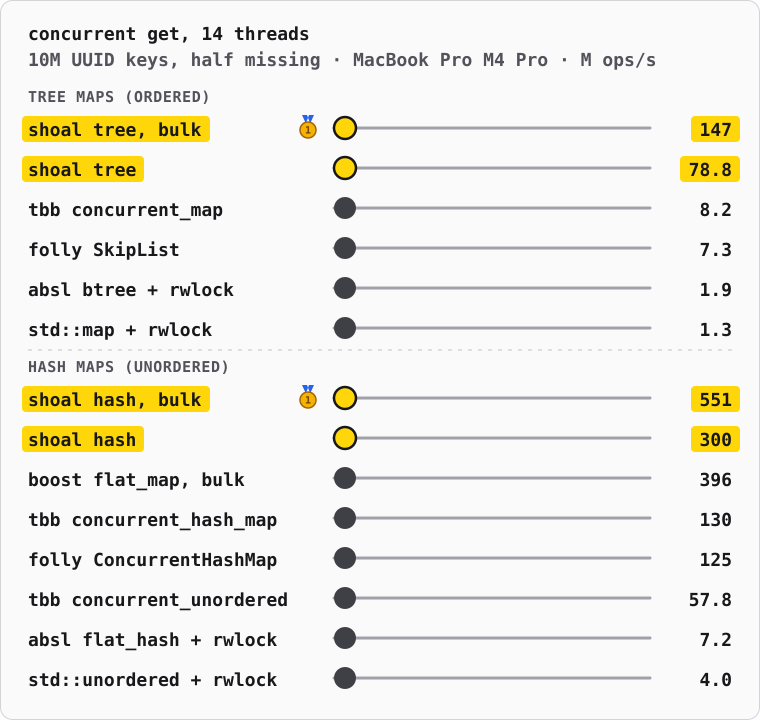

# bbtree-cpp

[](https://github.com/redox/bbtree-cpp/actions/workflows/cpp.yml?query=branch%3Amain)

A header-only C++17 port of [bbtree](https://github.com/XiangpengHao/bbtree),
the B+ tree ordered map by [Xiangpeng Hao](https://xiangpeng.systems).

This fork keeps only the C++ version. The Rust crate, its formal
verification, fuzzing and visualizer live upstream; the port keeps the same
data structure, node layouts and algorithms, and was measured against the
Rust crate on the same workloads before the Rust code left this repository
([PORTING.md](PORTING.md)). How the tree works:
[bbtree.xiangpeng.systems](https://bbtree.xiangpeng.systems/post) and the
upstream [design notes](https://github.com/XiangpengHao/bbtree/tree/8adae97a0ed97e5c98fa2790312eb0aec9719846/design) at `8adae97`, where this fork branched.

- Header-only C++17, zero dependencies, built to be embedded in DuckDB.
- `bbtree::BBTreeMap`: a concurrent map, latched nodes with optimistic reads.
- `bbtree::unsync::BBTreeMap` and `BBTreeSet`: single-threaded, with the
  `std::map`/`std::set` operations, entries, ranges and set algebra.
- Experimental hash maps after DuckDB's aggregate hash table:
  `bbtree::unsync::BBHashMap`, `bbtree::BBHashMap` (shards read without locks) and
  `bbtree::unsync::BBHashIndex` for rows stored elsewhere
  ([PORTING.md](PORTING.md#hash-maps)).
- SIMD node search on SSE2, AVX2, AVX-512 and NEON; tested on Linux, macOS
  and Windows (MSVC), and under AddressSanitizer, UBSan and ThreadSanitizer.



## Against other C++ maps

Upstream's README race, in C++, in two heats, tree maps and hash maps: 10M
random UUID keys, lookups of which half miss, on all 14 cores of a MacBook
Pro M4 Pro (10 performance, 4 efficiency), 2 seconds a map, one run.
Millions of lookups per second:

| tree maps (ordered) | M ops/s |
|---|--:|
| bbtree, bulk (`get_many_copied`, 64 keys a call) | **151.4** |
| bbtree (`get_copied`) | **74.9** |
| oneTBB `tbb::concurrent_map` (skip list) | 7.0 |
| folly `ConcurrentSkipList` | 6.3 |
| Abseil `absl::btree_map` + `std::shared_mutex` | 2.0 |
| `std::map` + `std::shared_mutex` | 1.4 |

| hash maps (unordered) | M ops/s |
|---|--:|
| bbtree `BBHashMap`, bulk (`get_many_copied`, 64 keys a call) | **260.5** |
| bbtree `BBHashMap` (`get_copied`) | **134.6** |
| Boost `boost::concurrent_flat_map`, bulk (`cvisit` over 64 keys) | 402.4 |
| oneTBB `tbb::concurrent_hash_map` | 133.2 |
| folly `ConcurrentHashMap` | 112.9 |
| oneTBB `tbb::concurrent_unordered_map` | 58.7 |
| Abseil `absl::flat_hash_map` + `std::shared_mutex` | 7.6 |
| `std::unordered_map` + `std::shared_mutex` | 4.3 |

bbtree's tree maps lead their heat by 11–22×. Its hash map comes second to
Boost's in bulk, and leads one key at a time. Boost's stores entries in
the slots it probes; bbtree's reaches them through descriptors and pages,
about twice the work a key (PORTING.md, Hash maps). Readers of both
bbtree maps write nothing shared: they check a version after reading.

The shared maps are built by every thread; a locked map by one thread, and
it takes its lock for every lookup. Every map must answer the same first
65,536 lookups right before it races. The bench is
[bench/race/race_bench.cpp](bench/race/race_bench.cpp), and this run's
output [bench/race/m4-pro-14-threads.csv](bench/race/m4-pro-14-threads.csv).
To run it (it needs oneTBB, folly, Abseil and Boost, e.g. from Homebrew):

```bash
cmake -B build-race -G Ninja -DCMAKE_BUILD_TYPE=Release -DBBTREE_RACE_BENCH=ON && cmake --build build-race --target race_bench && ./build-race/race_bench 10000000 14 2 | python3 bench/race/race_svg.py "MacBook Pro M4 Pro" > assets/readme-race.svg
```

## Performance against Rust

The C++ benches (`bench/`) ran against the Rust crate at `8adae97` on the
same workloads: same keys, same order. Setup: M4 Pro, system allocator,
`-mcpu=native`, one run each. A range means the numbers spread across runs
on a quiet machine. Full tables and the fixes behind them are in
[PORTING.md](PORTING.md#measurements).

Unsync map, ns per operation (lower is better):

| workload | Rust | C++ |
|---|--:|--:|
| 10M u64 insert, random | 246.6 | **224.8** |
| 10M u64 insert, sequential | **8.6** | 8.8 |
| 10M u64 get, hit / miss | 136.3 / 122.7 | **125.6 / 114.7** |
| 10M u64 remove, random | 279.0 | **220.7** |
| 1M path-string get, hit | 276 | **185** |
| 10M u64 range of 64, per scan | 481 | **407** |
| 10M u64 bulk insert / hit / miss, per key | 92.1 / 49.4 / 42.3 | **87.5 / 46.1** / 42.3 |

Unsync sets of u64, ns per element:

| workload | Rust | C++ |
|---|--:|--:|
| two 1M sets: difference / intersection / union | 7.1 / 6.8 / 6.6 | 6.8 / 6.8 / 6.9 |
| 27K set into 1M: intersection / `is_subset` | 29.3 / 26.9 | **22.1 / 19.5** |

Shared map, 10M u64, millions of operations per second (higher is better):

| workload | Rust | C++ |
|---|--:|--:|
| insert, 1 / 4 / 8 threads | 4.4 / 17.0–17.3 / 31.3–31.6 | 4.4 / 16.1–16.4 / 29.1–29.7 |
| `get_copied`, 1 / 4 / 8 threads | 8.4 / 33.6–34.3 / 61.7–66.0 | 8.4–8.8 / 34.1–34.8 / 53.5–63.3 |
| bulk get, 1 thread | 17.5–17.7 | **18.0** |
| bulk get, 8 threads | 117.2–134.7 | 113.1–126.0 |

The shared-map throughput rows predate the last round of fixes: inlining
the lookup and insert paths, one acquire-release CAS per latch, and `isb`
spin waits on Arm. Instruction counts since then: a shared get runs 341
instructions against Rust's 357, and a shared insert 685 against 676, at
parity in cycles. Multi-threaded throughput still needs a re-run on a quiet
machine. MSVC builds are tested but not measured.

## Usage

Add `src` to the include path, or with CMake:

```cmake
add_subdirectory(bbtree-cpp)
target_link_libraries(your_target PRIVATE bbtree)
```

### Concurrent map

```cpp
#include <bbtree/map.hpp>

bbtree::BBTreeMap<std::uint64_t, std::uint64_t> map;

std::thread a([&] { map.insert(1, 10); });
std::thread b([&] { map.insert(2, 20); });
a.join();
b.join();

assert(map.get_copied(1) == 10u);
assert(map.read(2, [](const auto&, const auto& value) { return value + 1; }) == 21u);
map.scan(bbtree::Bound<std::uint64_t>::unbounded(), bbtree::Bound<std::uint64_t>::unbounded(),
         [](const auto& key, const auto& value) { return true; /* keep going */ });
```

`insert` returns an `InsertOutcome`: the previous value, or an
`InsertError` when allocation failed, leaving the map unchanged.

### Single thread

```cpp
#include <bbtree/unsync/map.hpp>

bbtree::unsync::BBTreeMap<std::uint64_t, std::string> map;
map.insert(1, "one");
map.insert(2, "two");
assert(*map.get(1) == "one");
for (const auto& [key, value] : map) { /* in key order */ }
```

### Keys and values

- Keys and values must be trivially relocatable: the nodes move them as
  bytes. Trivially copyable types are; `std::vector`, `std::unique_ptr`,
  `std::shared_ptr` and libc++'s `std::string` are declared so.
  libstdc++'s `std::string` is not: use `std::vector<uint8_t>` or a
  `std::string_view` into stable storage.
- Keys order by `operator<`. Comparisons must not throw.
- Specialize `bbtree::InlineKey<K>` for the fastest lookups on your own key
  types; the byte strings and 64/128-bit integers come specialized.
- Bulk lookups and inserts (`get_many_copied`, `read_many`,
  `insert_many`) overlap their keys' memory latency: use them when the
  semantics allow.

## Build and test

```bash
cmake -B build -G Ninja && cmake --build build && ctest --test-dir build --output-on-failure
```

`-DBBTREE_SANITIZE="address;undefined"` (or `thread`) builds the tests
under sanitizers; `-DBBTREE_NATIVE=OFF` drops `-march=native`. The
benchmarks are `bench/*_bench.cpp`.

## License

Licensed under either of Apache License, Version 2.0 or MIT license, at
your option; [LICENSE](LICENSE) holds both texts.

Unless you explicitly state otherwise, any contribution intentionally
submitted for inclusion in bbtree by you, as defined in the Apache-2.0
license, shall be dual licensed as above, without any additional terms or
conditions.
