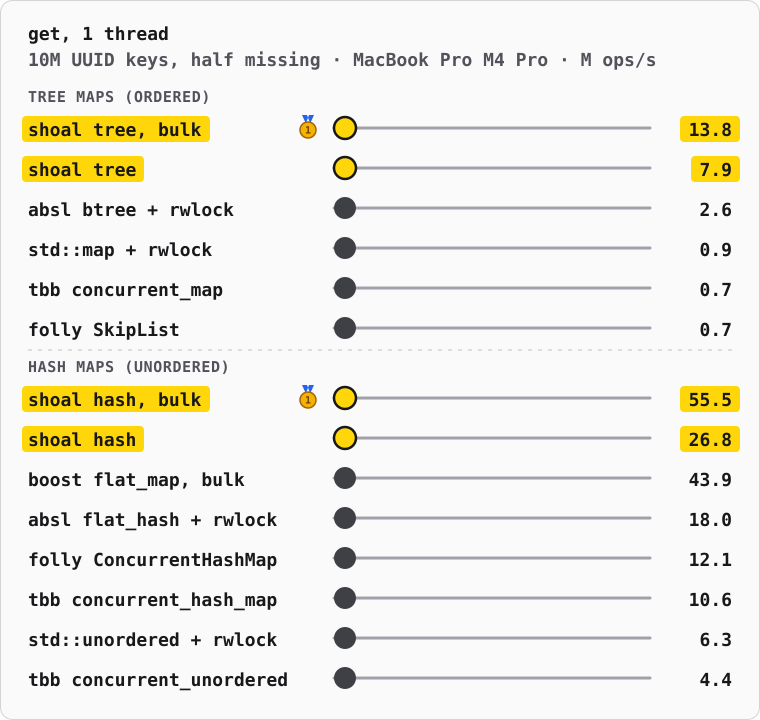
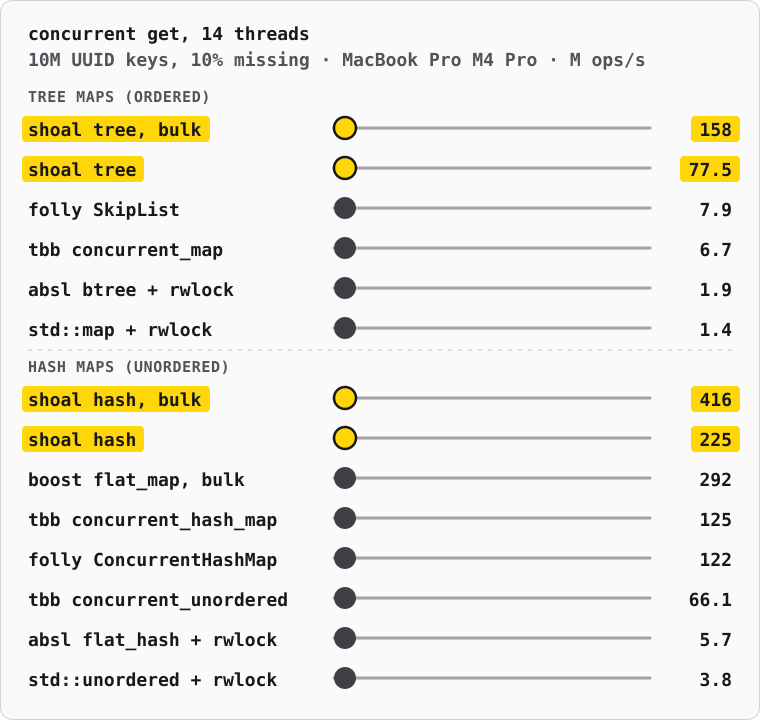

# shoal

[](https://github.com/redox/shoal/actions/workflows/cpp.yml?query=branch%3Amain)

Header-only C++17 maps that many threads read at once: an ordered tree map
and a hash map, whose readers write nothing shared.

The tree map is a port of [bbtree](https://github.com/XiangpengHao/bbtree),
the Blessed B-tree by [Xiangpeng Hao](https://xiangpeng.systems), a Rust
B+ tree. The port keeps its data structure, node layouts and algorithms,
and was measured against the Rust crate on the same workloads
([design/02-rust-parity.md](design/02-rust-parity.md)); the Rust crate, its formal verification,
fuzzing and visualizer live upstream. How the tree works:
[bbtree.xiangpeng.systems](https://bbtree.xiangpeng.systems/post) and the
upstream [design notes](https://github.com/XiangpengHao/bbtree/tree/8adae97a0ed97e5c98fa2790312eb0aec9719846/design) at `8adae97`, where this fork branched. The fork's own
design notes and decisions are in [design/](design/00-init.md).

- Header-only C++17, zero dependencies, built to be embedded in DuckDB.
- `shoal::TreeMap`: a concurrent ordered map, latched nodes with optimistic
  reads.
- `shoal::unsync::TreeMap` and `TreeSet`: single-threaded, with the
  `std::map`/`std::set` operations, entries, ranges and set algebra.
- `shoal::HashMap`: a concurrent hash map, entries in the slots it probes,
  read without locks; `shoal::unsync::HashMap`, single-threaded with stable
  references, and `shoal::unsync::HashIndex` for rows stored elsewhere,
  after DuckDB's aggregate hash table ([design/05-hash-maps.md](design/05-hash-maps.md)).
- SIMD node search on SSE2, AVX2, AVX-512 and NEON; tested on Linux, macOS
  and Windows (MSVC), and under AddressSanitizer, UBSan and ThreadSanitizer.


## Against other C++ maps

Upstream's README race, in C++, in two heats, tree maps and hash maps: 10M
random UUID keys, lookups of which half miss, on all 14 cores of a MacBook
Pro M4 Pro (10 performance, 4 efficiency), 2 seconds a map, one run.
Millions of lookups per second:

| tree maps (ordered) | M ops/s |
|---|--:|
| shoal `TreeMap`, bulk (`get_many_copied`, 64 keys a call) | **152.4** |
| shoal `TreeMap` (`get_copied`) | **83.9** |
| folly `ConcurrentSkipList` | 8.5 |
| oneTBB `tbb::concurrent_map` (skip list) | 7.6 |
| Abseil `absl::btree_map` + `std::shared_mutex` | 2.1 |
| `std::map` + `std::shared_mutex` | 1.4 |

| hash maps (unordered) | M ops/s |
|---|--:|
| shoal `HashMap`, bulk (`get_many_copied`, 64 keys a call) | **471.0** |
| shoal `HashMap` (`get_copied`) | **310.2** |
| Boost `boost::concurrent_flat_map`, bulk (`cvisit` over 64 keys) | 402.6 |
| oneTBB `tbb::concurrent_hash_map` | 143.4 |
| folly `ConcurrentHashMap` | 121.7 |
| oneTBB `tbb::concurrent_unordered_map` | 46.3 |
| Abseil `absl::flat_hash_map` + `std::shared_mutex` | 8.1 |
| `std::unordered_map` + `std::shared_mutex` | 4.5 |

shoal leads both heats: its tree map by 10–18×, its hash map by 17% over
Boost's in bulk (5–17% over four runs of the same binary) and 2× over the
rest one key at a time. Readers of both shoal maps write nothing shared: they check a version after reading
([design/05-hash-maps.md](design/05-hash-maps.md)). The UUID hash declares `is_avalanching`, which
both shoal and Boost read as leave to use it unmixed.

On one thread nothing contends, and a locked map's lock costs it little:
shoal's hash map in bulk runs 5% ahead of Boost's (45.6 against 43.5
M/s), one key at a time ahead of every other (25.1), and its tree map
leads Abseil's B-tree 5.3× (14.2 against 2.7):



With every key in cache (100K keys), shoal's hash map in bulk leads
Boost's too: 120 against 110 M/s, 164 against 158 with 90% found
([design/06-race.md](design/06-race.md)).

With 90% of the lookups finding their key, every hit reads its slot:
shoal's hash map in bulk leads Boost's by 38% (443 against 321 M/s), and
its tree map holds its lead (171 against folly's 8.6):



The shared maps are built by every thread; a locked map by one thread, and
it takes its lock for every lookup. Every map must answer the same first
65,536 lookups right before it races. The bench is
[bench/race/race_bench.cpp](bench/race/race_bench.cpp); the runs' output is
in [bench/race/m4-pro-14-threads.csv](bench/race/m4-pro-14-threads.csv),
[m4-pro-1-thread.csv](bench/race/m4-pro-1-thread.csv) and
[m4-pro-14-threads-90-hit.csv](bench/race/m4-pro-14-threads-90-hit.csv),
one run each. To build it (it needs oneTBB, folly, Abseil and Boost, e.g.
from Homebrew):

```bash
cmake -B build-race -G Ninja -DCMAKE_BUILD_TYPE=Release -DSHOAL_RACE_BENCH=ON && cmake --build build-race --target race_bench
```

Then each chart: entries, threads, seconds a map, maps to run (`""` for
all), and the percentage of lookups that find their key:

```bash
./build-race/race_bench 10000000 14 2 | python3 bench/race/race_svg.py "MacBook Pro M4 Pro" > assets/readme-race.svg
```

```bash
./build-race/race_bench 10000000 1 2 | python3 bench/race/race_svg.py "MacBook Pro M4 Pro" > assets/readme-race-1-thread.svg
```

```bash
./build-race/race_bench 10000000 14 2 "" 90 | python3 bench/race/race_svg.py "MacBook Pro M4 Pro" > assets/readme-race-90-hit.svg
```

## The tree map against the Rust bbtree

The C++ benches (`bench/`) ran against the Rust crate at `8adae97` on the
same workloads: same keys, same order. Setup: M4 Pro, system allocator,
`-mcpu=native`, one run each. A range means the numbers spread across runs
on a quiet machine. Full tables and the fixes behind them are in
[design/02-rust-parity.md](design/02-rust-parity.md); the race, in [design/06-race.md](design/06-race.md).

Unsync map, ns per operation (lower is better):

| workload | Rust | C++ |
|---|--:|--:|
| 10M u64 insert, random | 246.6 | **224.8** |
| 10M u64 insert, sequential | **8.6** | 8.8 |
| 10M u64 get, hit / miss | 136.3 / 122.7 | **125.6 / 114.7** |
| 10M u64 remove, random | 279.0 | **220.7** |
| 1M path-string get, hit | 276 | **185** |
| 10M u64 range of 64, per scan | 481 | **407** |
| 10M u64 bulk insert / hit / miss, per key | 92.1 / 49.4 / 42.3 | **87.5 / 46.1** / 42.3 |

Unsync sets of u64, ns per element:

| workload | Rust | C++ |
|---|--:|--:|
| two 1M sets: difference / intersection / union | 7.1 / 6.8 / 6.6 | 6.8 / 6.8 / 6.9 |
| 27K set into 1M: intersection / `is_subset` | 29.3 / 26.9 | **22.1 / 19.5** |

Shared map, 10M u64, millions of operations per second (higher is better):

| workload | Rust | C++ |
|---|--:|--:|
| insert, 1 / 4 / 8 threads | 4.4 / 17.0–17.3 / 31.3–31.6 | 4.4 / 16.1–16.4 / 29.1–29.7 |
| `get_copied`, 1 / 4 / 8 threads | 8.4 / 33.6–34.3 / 61.7–66.0 | 8.4–8.8 / 34.1–34.8 / 53.5–63.3 |
| bulk get, 1 thread | 17.5–17.7 | **18.0** |
| bulk get, 8 threads | 117.2–134.7 | 113.1–126.0 |

The shared-map throughput rows predate the last round of fixes: inlining
the lookup and insert paths, one acquire-release CAS per latch, and `isb`
spin waits on Arm. Instruction counts since then: a shared get runs 341
instructions against Rust's 357, and a shared insert 685 against 676, at
parity in cycles. Multi-threaded throughput still needs a re-run on a quiet
machine. MSVC builds are tested but not measured.

## Usage

Add `src` to the include path, or with CMake:

```cmake
add_subdirectory(shoal)
target_link_libraries(your_target PRIVATE shoal)
```

### Concurrent tree map

```cpp
#include <shoal/map.hpp>

shoal::TreeMap<std::uint64_t, std::uint64_t> map;

std::thread a([&] { map.insert(1, 10); });
std::thread b([&] { map.insert(2, 20); });
a.join();
b.join();

assert(map.get_copied(1) == 10u);
assert(map.read(2, [](const auto&, const auto& value) { return value + 1; }) == 21u);
map.scan(shoal::Bound<std::uint64_t>::unbounded(), shoal::Bound<std::uint64_t>::unbounded(),
         [](const auto& key, const auto& value) { return true; /* keep going */ });
```

`insert` returns an `InsertOutcome`: the previous value, or an
`InsertError` when allocation failed, leaving the map unchanged.

### Single-threaded tree map

```cpp
#include <shoal/unsync/map.hpp>

shoal::unsync::TreeMap<std::uint64_t, std::string> map;
map.insert(1, "one");
map.insert(2, "two");
assert(*map.get(1) == "one");
for (const auto& [key, value] : map) { /* in key order */ }
```

### Concurrent hash map

```cpp
#include <shoal/hash_map.hpp>

shoal::HashMap<std::uint64_t, std::uint64_t> map;
map.insert(1, 10);
map.update(1, [](const auto&, auto& value) { ++value; });
assert(map.get_copied(1) == 11u);

std::uint64_t keys[] = {1, 2};
std::optional<std::uint64_t> values[2];
map.get_many_copied(keys, 2, values);  // bulk: {11, none}
```

Lookups of keys and values that are trivially copyable take no lock; other
types hold the key's shard shared.

### Keys and values

- Keys and values must be trivially relocatable: the nodes move them as
  bytes. Trivially copyable types are; `std::vector`, `std::unique_ptr`,
  `std::shared_ptr` and the `std::string` of libc++ and MSVC are declared
  so. libstdc++'s `std::string` is not: use `std::vector<uint8_t>` or a
  `std::string_view` into stable storage.
- Keys order by `operator<`. Comparisons must not throw.
- Specialize `shoal::InlineKey<K>` for the fastest lookups on your own key
  types; the byte strings and 64/128-bit integers come specialized.
- Bulk lookups and inserts (`get_many_copied`, `read_many`,
  `insert_many`) overlap their keys' memory latency: use them when the
  semantics allow.

## Build and test

```bash
cmake -B build -G Ninja && cmake --build build && ctest --test-dir build --output-on-failure
```

`-DSHOAL_SANITIZE="address;undefined"` (or `thread`) builds the tests
under sanitizers; `-DSHOAL_NATIVE=OFF` drops `-march=native`. The
benchmarks are `bench/*_bench.cpp`.

## License

Licensed under either of Apache License, Version 2.0 or MIT license, at
your option; [LICENSE](LICENSE) holds both texts.

Unless you explicitly state otherwise, any contribution intentionally
submitted for inclusion in shoal by you, as defined in the Apache-2.0
license, shall be dual licensed as above, without any additional terms or
conditions.
