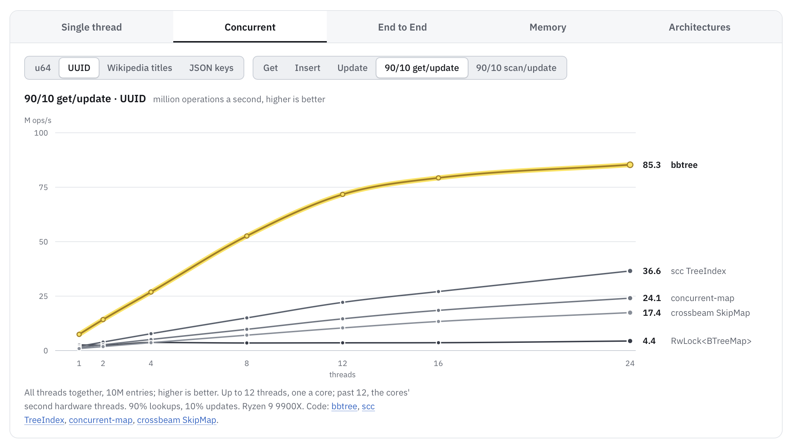

# bbtree

[](https://crates.io/crates/bbtree)
[](https://docs.rs/bbtree)\
[](https://github.com/XiangpengHao/bbtree/actions/workflows/ci.yml?query=branch%3Amain)
[](https://github.com/XiangpengHao/bbtree/actions/workflows/miri.yml?query=branch%3Amain)
[](https://github.com/XiangpengHao/bbtree/actions/workflows/sanitizer.yml?query=branch%3Amain)
[](https://github.com/XiangpengHao/bbtree/actions/workflows/shuttle.yml?query=branch%3Amain)
[](https://github.com/XiangpengHao/bbtree/actions/workflows/fuzz.yml?query=branch%3Amain)

> B-trees are by far the most important access path structure in database and file systems.
> — [Jim Gray](https://en.wikipedia.org/wiki/Jim_Gray_(computer_scientist))


bbtree is by far the fastest btree (ordered map):
1. 5x faster than std's `BTreeMap` at single thread, 7x faster than `crossbeam-skiplist` at 12 threads.
2. 30% lower memory usage, 5x lower p99 latency.
3. Zero dependencies, `no_std` compatible.
4. `unsync::BBTreeMap` is a **drop-in replacement** for std's `BTreeMap`/`BTreeSet`.
5. Production-ready by formal verification, model checking, fuzzing, and lots of testing.
6. Brought to you by decades of database research and careful curation by [Xiangpeng Hao](https://xiangpeng.systems).



Checkout how it works at [bbtree.xiangpeng.systems](https://bbtree.xiangpeng.systems/post/bbtree-internals/).

## Usage

```bash
cargo add bbtree
```

### Concurrent bbtree

```rust
use bbtree::BBTreeMap;

let map = BBTreeMap::new();

std::thread::scope(|scope| {
    scope.spawn(|| map.insert(1_u64, 10_u64));
    scope.spawn(|| map.insert(2, 20));
});

assert_eq!(map.get_copied(&1), Some(10));
assert_eq!(map.read(&2, |_, value| value + 1), Some(21));
assert_eq!(map.get_many_copied([&1, &2, &3]), [Some(10), Some(20), None]);
```

### Single thread

```rust
use bbtree::unsync::BBTreeMap;

let mut map = BBTreeMap::new();
map.insert(1, "one");
map.insert(2, "two");
assert_eq!(map.get(&1), Some(&"one"));
```

## license

Licensed under either of Apache License, Version 2.0 or MIT license, at
your option; [LICENSE](LICENSE) holds both texts.

Unless you explicitly state otherwise, any contribution intentionally
submitted for inclusion in bbtree by you, as defined in the Apache-2.0
license, shall be dual licensed as above, without any additional terms or
conditions.
